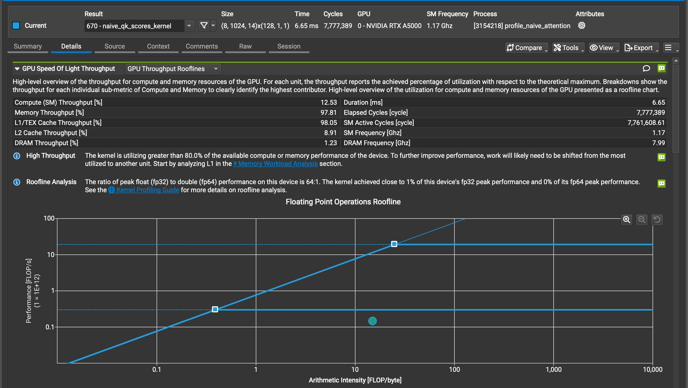
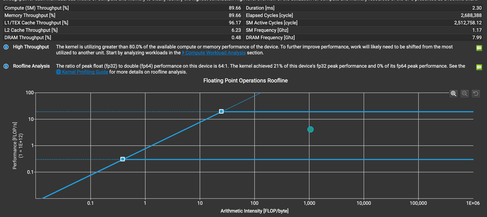
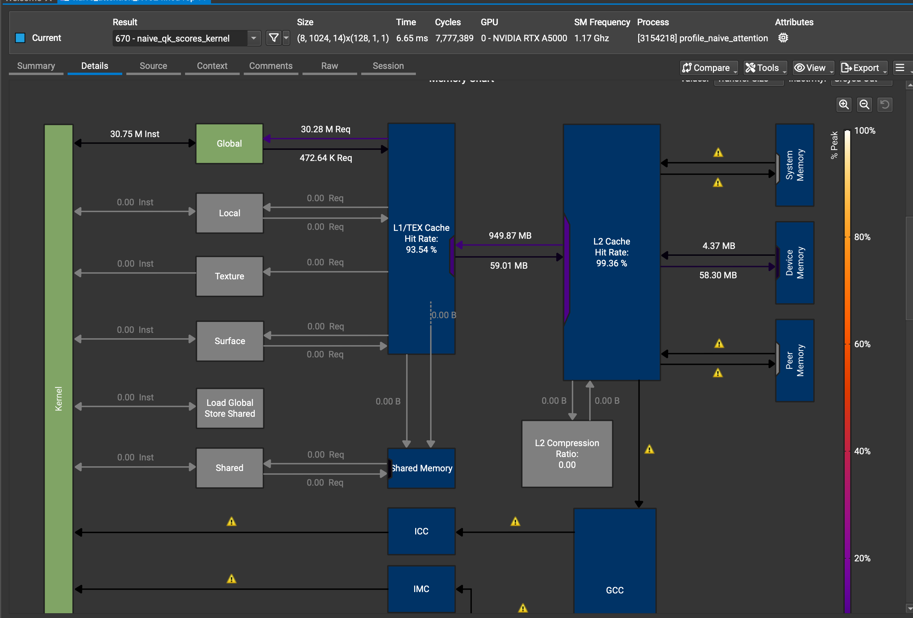
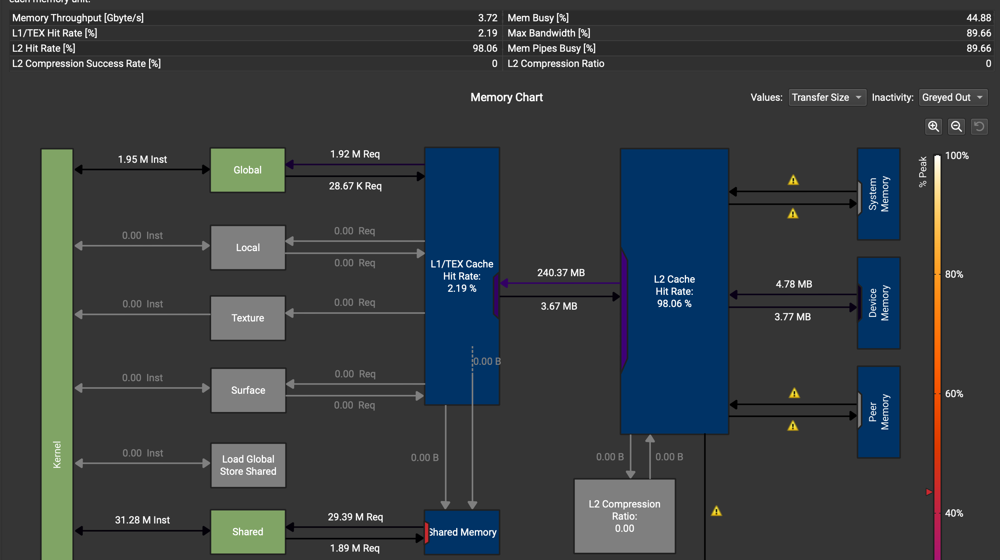
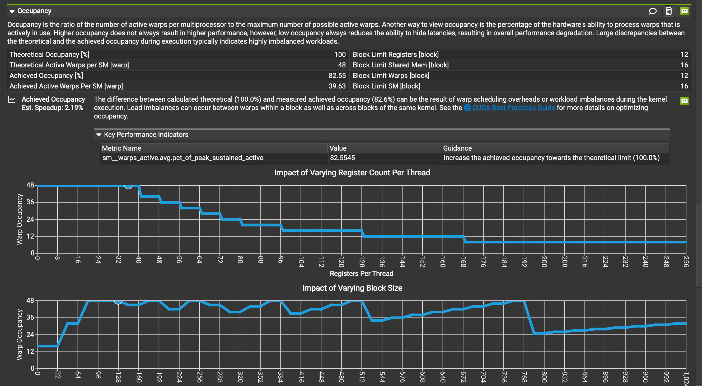
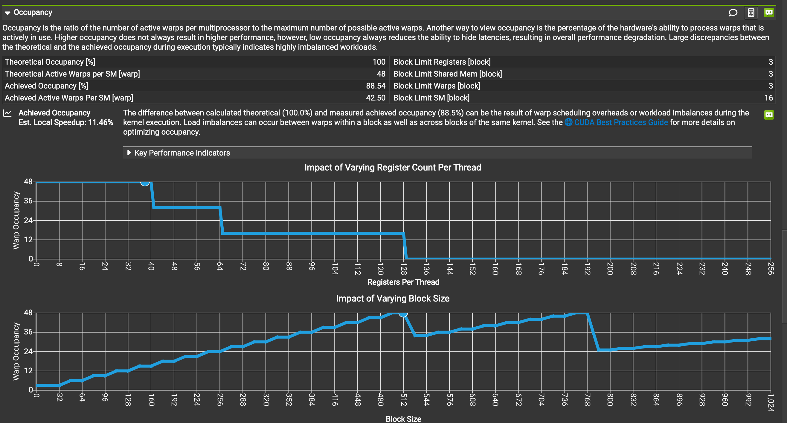

# FlashAttention from Scratch: Fused CUDA Prefill Attention for Qwen2-0.5B

A from-scratch, raw-CUDA implementation of the **FlashAttention forward pass** (tiled, fused, online softmax) for **N-token prefill** of Qwen2.5-0.5B-Instruct, compared against a CPU reference and a naive GPU baseline that materializes the full N×N attention matrix. Unlike the heavily templated, multi-dtype kernels in FlashAttention, PyTorch SDPA and xFormers, it targets one configuration: FP32, head dim 64, causal, GQA.

## Build and run

Requirements: NVIDIA GPU with the CUDA Toolkit, CMake ≥ 3.27, a C++20 compiler, and the [Qwen2.5-0.5B-Instruct](https://huggingface.co/Qwen/Qwen2.5-0.5B-Instruct) weights in `models/Qwen2.5-0.5B-Instruct` (or point `$TRANSFORMER_MODEL_DIR` at them).

```bash
hf download Qwen/Qwen2.5-0.5B-Instruct --local-dir models/Qwen2.5-0.5B-Instruct

cmake --fresh -S . -B build && cmake --build build -j
ctest --test-dir build                 # 12 correctness tests

./build/flashattentiontest             # naive vs flash: correctness + timing
./build/flashattentionsweep            # RPB x BC tile-size sweep
./build/flashprefilltest               # end-to-end bf16 prefill, tok/s
./build/transformer --interactive      # chat with the model (decode mode)

# Nsight Compute report (roofline, memory, occupancy)
ncu --set full --launch-skip 1 --launch-count 1 -o profiling/flash_attention_N512 ./build/profile_flash_attention 512
```

The PyTorch reference in [pyref/](pyref/README.md) uses Python 3.13, Torch 2.7.0, safetensors 0.5.3 and transformers 4.51.3.

## Results

RTX A5000, FP32, causal + GQA, N = 512–4096:

- **16–29× less HBM traffic** than the naive kernels
- **~4× faster** attention kernel (3.8–4.4×)
- **Memory-bound → compute-bound:** ~1% → ~21% of FP32 peak, 80–90% SM throughput
- **Zero shared-memory bank conflicts**, 79% achieved occupancy
- **Numerically exact:** ≤ 1.2e-6 max abs. error vs the CPU reference, which is within 1e-5 of PyTorch and FP64

| metric (N = 512 / 1024) | naive | FlashAttention |
|---|---|---|
| HBM traffic (rd+wr) | 64 / 245 MB | **3.9 / 8.4 MB** |
| arithmetic intensity | ~7 FLOP/B (memory-bound) | **~120 / ~10³ FLOP/B (compute-bound)** |
| achieved FP32 peak | ~1% | **~21%** |
| SM throughput | 12.8% (QKᵀ) | **80–90%** |
| DRAM throughput | up to 94% (softmax) | <1% |
| L1 hit rate | 93.5% | ~2% (reuse is in shared memory) |
| achieved occupancy | 63–95% | 79% |
| shared-mem bank conflicts | ~9.2k (softmax) | **0** |
| shared mem / block | 0–1 KB | 16 KB (K/V tiles) |

Removing the O(N²) S/P traffic (~90% of the naive bytes) lifts arithmetic intensity past the A5000 roofline ridge (~36 FLOP/B). For context, the naive GPU kernels are already ~85× faster than a single-threaded CPU.

**End to end** (full bf16 prefill, N = 512): 246 tok/s with either kernel (1.00×). This is expected: attention is a small slice of the model, and the in-model prefill already streamed with online softmax, so the kernel-level gain doesn't carry over.

Nsight Compute at N = 1024 (naive: dominant QKᵀ kernel only):

| | Naive | FlashAttention |
|---|---|---|
| Roofline |  |  |
| Memory workload |  |  |
| Occupancy |  |  |

Full analysis: [naive baseline](profiling/naive_baseline.md) and [naive vs FlashAttention](profiling/flash_vs_naive.md).

## Kernel design

- **Layout:** Q, O `[H, N, d]`; K, V `[Hkv, N, d]`; GQA mapping `kv(h) = h·Hkv/H`; scale `1/√d`; d = 64.
- **Threads:** one warp per query row; each lane owns 2 head dims (`lane`, `lane+32`), and dot products use warp shuffles.
- **Tiling:** `RPB = 16` query rows per block share each `BC = 32`-key K/V tile in shared memory (16 KB per block); grid `(heads, ⌈N/RPB⌉)`. A tile-size sweep puts all RPB×BC configurations within 5% of each other.
- **Online softmax** (Milakov–Gimelshein): running max `m`, running denominator `l`, and a rescaled output accumulator.
- **Causal masking:** fully masked tiles are skipped and the diagonal tile is masked per key; NaN-safe at `m = −∞`.

## References

- T. Dao et al., *FlashAttention: Fast and Memory-Efficient Exact Attention with IO-Awareness*, NeurIPS 2022.
- T. Dao, *FlashAttention-2: Faster Attention with Better Parallelism and Work Partitioning*, 2023.
- M. Milakov, N. Gimelshein, *Online normalizer calculation for softmax*, 2018.
- PyTorch reference model based on the [Hugging Face Qwen2 implementation](https://github.com/huggingface/transformers/blob/8f1509a96c96747c893051ac947795cfb0750357/src/transformers/models/qwen2/modeling_qwen2.py).
